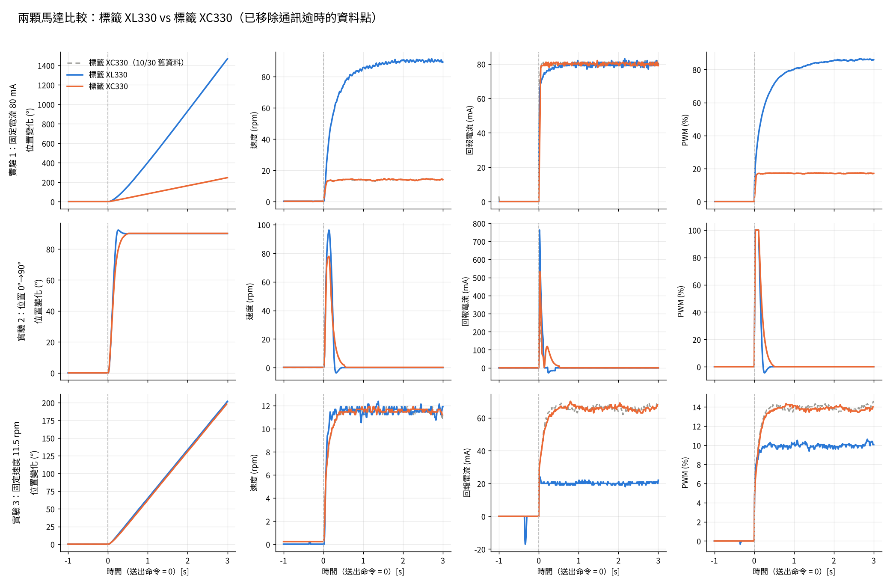
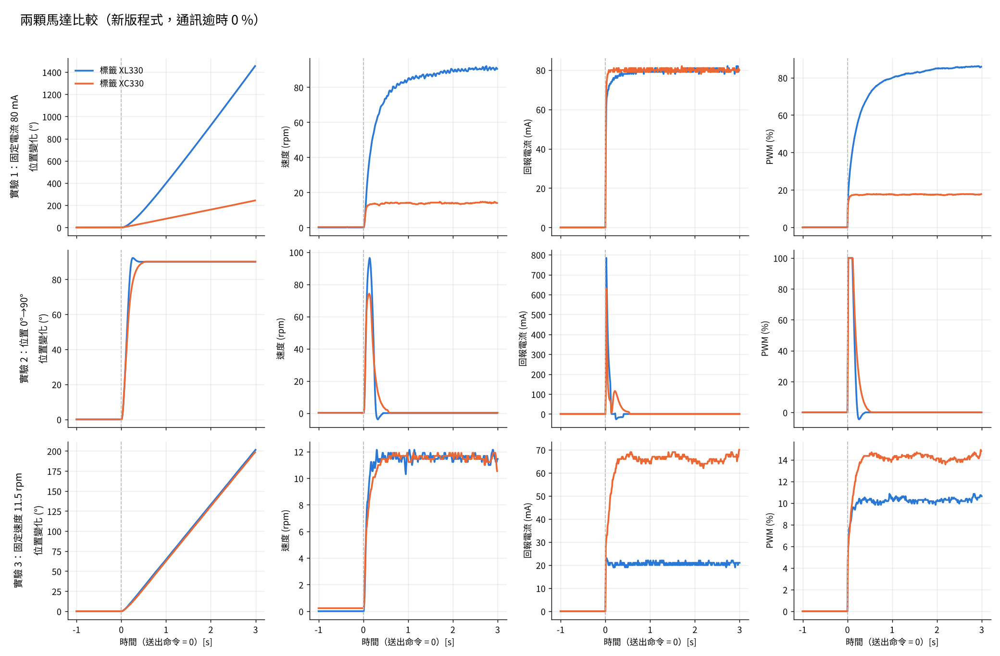
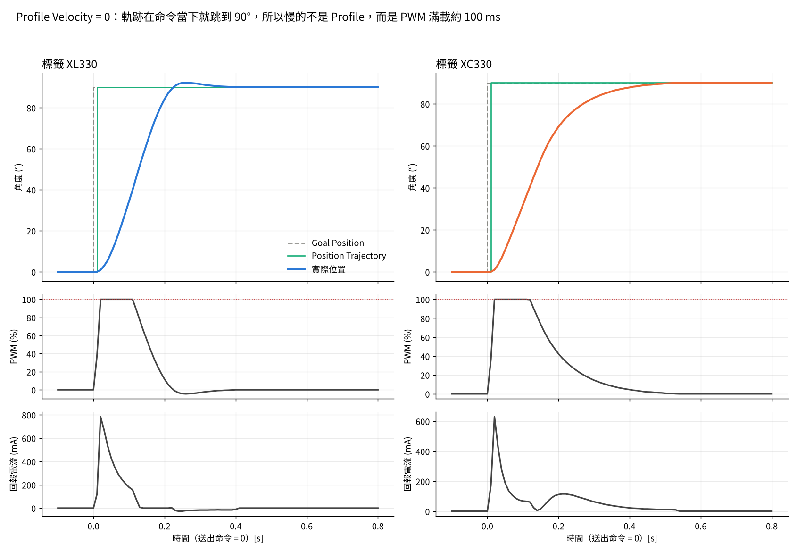
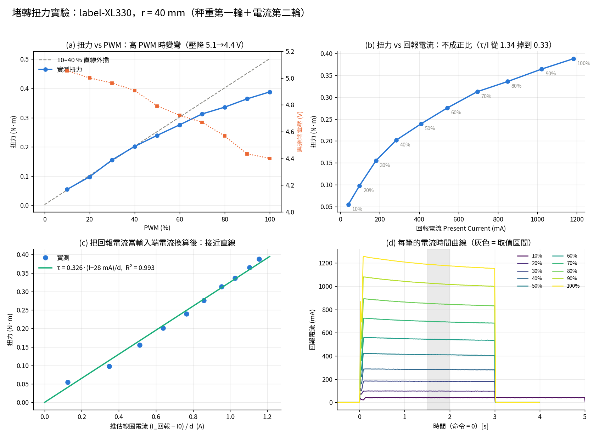

# XL330 / XC330 實驗紀錄（2026-11-05 晚 ～ 11-06）

> 對應計畫：`docs/XL330_XC330_Characterization_Plan_v3.2.pdf` 第零部分（0A 身分確認、0C 非破壞性比較的前導測試）
> 實驗架構筆記（Claude Docs）：https://claude.ai/artifact/8mrvAQ9jXWS7qA5kpFjrcm

---

## 1. 結論

1. **標籤 XC330-M288PG 的那顆，不是原廠規格的 XC330-M288-T。** 證據有三個：
   - DYNAMIXEL Wizard 讀到的是 **XL330**（Model Number 1200，不是 XC330 的 1240）
   - 重量 **19.8 g**：原廠 XC330 是 23 g，XL330 是 18 g，這顆兩個都不像
   - 和真正的 XL330 相比，**行為差很多**（見第 4 節），所以也不是單純貼錯標籤的 XL330
2. **它的摩擦大很多。** 同樣維持 11.5 rpm，它需要的電流是標籤 XL330 那顆的 **3.3 倍**（66 mA 比 20 mA）。這可以解釋教授問的「80 mA 為什麼只到 14 rpm」：80 mA 幾乎全部用來抵抗摩擦。
3. **10/30 那次測的就是這顆**。11/06 用舊版和新版程式各重測一次，三次的數字幾乎一樣，所以差異可以重現，不是偶然。
4. 新版程式讀回的 Control Table 顯示，它的**韌體版本（53）和所有預設值都和 XL330 完全相同**（見第 4b 節）。
5. **堵轉扭力實驗（標籤 XL330）顯示回報電流不是線圈電流**：扭力和回報電流不成正比，但和 (I_回報 − 28 mA)/d 成正比（R² = 0.993），支持「回報的是電源輸入端電流」（目前只有一顆、一輪）。見第 4c 節。
6. 這顆內部**到底是什麼**（齒輪材質、馬達型號），不拆開沒辦法確定。目前的資料比較支持「內部和 XL330 不同」，例如金屬齒輪或不同的馬達，但還不能當結論。

---

## 2. 馬達身分（0A）

| 項目 | 標籤 XL330 | 標籤 XC330-M288PG | 原廠 XL330-M288 | 原廠 XC330-M288 |
|---|---|---|---|---|
| Wizard 顯示的型號 | XL330 | **XL330** | — | — |
| Model Number | 1200 | 1200（10/27 讀過，今天 Wizard 也顯示 XL330） | 1200 | 1240 |
| 重量 | **18.0 g** | **19.8 g** | 18 g | 23 g |
| 齒輪 / 馬達（規格） | — | 未知 | 工程塑膠 / 有鐵芯 | 全金屬、2 軸承 / 無鐵芯 |
| 5 V 堵轉扭矩 / 空載轉速 | 未量 | 未量 | 0.52 N·m / 103 rpm | 0.93 N·m / 81 rpm |

- 原廠規格出處：ROBOTIS e-Manual [XL330-M288](https://emanual.robotis.com/docs/en/dxl/x/xl330-m288/)、[XC330-M288](https://emanual.robotis.com/docs/en/dxl/x/xc330-m288/)
- 待確認：兩顆秤重時的條件是否相同（有沒有裝輸出盤、螺絲、線）。

---

## 3. 實驗條件

- 控制器：Nucleo-F446RE，USART1 半雙工 1 Mbps（PA9 / D8），上拉 1.6 kΩ 到 3V3
- 馬達電源：電源供應器 5 V；今晚量過一次，麵包板上的馬達端只有 **4.2 V**（實驗時的實際電壓沒有記錄）
- 記錄：100 Hz，命令在 t = 1.0 s 送出，每個實驗 4 s
- 三個實驗：
  1. 電流模式，Goal Current 80 mA
  2. 位置模式，0° → 90°（1024 counts）
  3. 速度模式，Goal Velocity 50（約 11.5 rpm）
- **注意：** 今天這兩份 CSV 是 **8 欄格式**（`exp,t_ms,tick,pwm,cur,vel,pos,err`），是 10/30 的舊版程式錄的，不是 11/5 晚上燒的新版（11 欄，多了 `vtraj,ptraj,goal` 和 `# cfg` 設定行）。所以這兩次的馬達設定（增益、Return Delay）沒有記錄到。

---

## 4. 結果



完整數字見 `data/summary_metrics_1106.csv`。分析程式 `analysis/analyze_1106.py` 可以從原始資料重算。

| 指標 | 標籤 XL330 | 標籤 XC330 | 標籤 XC330（10/30） |
|---|---|---|---|
| 實驗 1：80 mA 穩態速度 | **90.1 rpm** | **14.0 rpm** | 14.0 rpm |
| 實驗 1：穩態 PWM | 85.8 % | 17.1 % | 17.2 % |
| 實驗 3：維持 11.5 rpm 的電流 | **20.2 mA** | **65.5 mA** | 65.8 mA |
| 實驗 3：穩態 PWM | 10.0 % | 13.8 % | 13.9 % |
| 實驗 2：上升時間（10→90 %） | 0.15 s | 0.20 s | 0.22 s |
| 實驗 2：超越量 | 2.2° | 0.09° | 0.09° |
| 實驗 2：安定時間（±0.9°） | 0.32 s | 0.44 s | 0.43 s |
| 實驗 2：峰值速度 | 96.2 rpm | 77.9 rpm | 77.4 rpm |
| 通訊逾時比例 | 2.4 % | **37.4 %** | 0 % |

（穩態 = 命令後 2～3 s 的平均；逾時的資料列已先刪掉）

---

## 4b. 11/06 下午：修好 `dxl.c` 後用新版程式重錄

`dxl.c` 改成直接讀暫存器（見第 7 節除錯紀錄）之後，兩顆都用**新版程式（11 欄、含 `# cfg` 和軌跡）**重錄了一次。分析程式：`analysis/analyze_1106_v2.py`，指標：`data/summary_metrics_v2_1106.csv`。



**通訊逾時都變成 0 %**（舊版程式是 2.4 % 和 37 %）。原來的逾時和 ping 失敗是**同一個原因**：overrun 讓封包被截斷。

**兩顆的開機設定完全一樣**（`# cfg[boot]`）：

| 項目 | 兩顆讀到的值 | 原廠 XL330 預設 | 原廠 XC330 預設 |
|---|---|---|---|
| Model Number / 韌體 | 1200 / 53 | 1200 | 1240 |
| Current Limit | 1750 | 1750 | 2352 |
| Velocity Limit | 445 | 445 | 350 |
| Position P / I / D | 400 / 0 / 0 | 400 / 0 / 0 | 1100 / 0 / 500 |
| Velocity P / I | 180 / 1600 | 180 / 1600 | 50（P） |

→ 標籤 XC330 那顆的**韌體和所有預設值都是 XL330**。

**重現性**（同一顆、不同天或不同程式）：

| 資料 | 80 mA 穩態速度 | 11.5 rpm 所需電流 | 位置步階超越量 |
|---|---|---|---|
| 標籤 XL330｜11/06 新版 | 90.2 rpm | 20.6 mA | 2.2° |
| 標籤 XL330｜11/06 舊版 | 90.1 rpm | 20.2 mA | 2.2° |
| 標籤 XC330｜11/06 新版 | 14.0 rpm | 65.7 mA | 0.09° |
| 標籤 XC330｜11/06 舊版 | 14.0 rpm | 65.5 mA | 0.09° |
| 標籤 XC330｜10/30 舊版 | 14.0 rpm | 65.8 mA | 0.09° |

→ 三天、兩個版本的程式，結果幾乎一樣，**差異確定來自馬達本身**。

**老師 §7 的三條位置曲線：**



- `Profile Velocity = 0`、`Profile Acceleration = 0`，所以 **Position Trajectory 在命令當下就直接跳到 90°**，慢的不是 Profile。
- 兩顆的 **PWM 都滿載約 100 ms**，這段期間已經碰到電壓上限，只加大 P 增益沒有用（老師 §7 的判斷）。
- PWM 退出滿載之後：XL330 很快到達目標，還有 2.2° 過衝，PWM 甚至變成負的去煞車；XC 標籤這顆則是慢慢逼近（P 控制加上大摩擦），大約 0.45 s 才安定下來。

---

## 4c. 11/06 下午：堵轉扭力實驗（標籤 XL330，0C 第 1 項）

**方法**：PWM 模式（`w N 3`），手臂 r = 40 mm 頂住電子秤，馬達堵轉不動。扭力 τ = 秤重 × g × r。電流取命令後 1.5–2.0 s 的平均，對應讀秤的時間點。

**條件**：
- 馬達電源已改成**不經過麵包板**：V、G 直接接電源，麵包板只走資料線和共地。
- 通訊逾時 0 筆。手臂位置 2078 → 2085（整輪只動 0.6°），夾具穩定。溫度 26 → 32 °C。
- 秤重用**第一輪**的讀數，電流用**第二輪**的 log。兩輪秤重實際差異很小，但第二輪沒有逐筆記錄。

| PWM (%) | 10 | 20 | 30 | 40 | 50 | 60 | 70 | 80 | 90 | 100 |
|---|---|---|---|---|---|---|---|---|---|---|
| 秤重 (g) | 138.5 | 249.0 | 395.7 | 514.1 | 610.2 | 702.3 | 797.5 | 856.5 | 929.3 | 989.7 |
| 扭力 (N·m) | 0.054 | 0.098 | 0.155 | 0.202 | 0.239 | 0.275 | 0.313 | 0.336 | 0.365 | 0.388 |
| 回報電流 (mA) | 41 | 97 | 182 | 283 | 410 | 542 | 695 | 849 | 1022 | 1183 |
| 馬達端電壓 (V) | 5.06 | 5.00 | 4.96 | 4.91 | 4.79 | 4.72 | 4.67 | 4.57 | 4.43 | 4.40 |
| τ / 回報電流 (N·m/A) | 1.34 | 1.00 | 0.85 | 0.71 | 0.58 | 0.51 | 0.45 | 0.40 | 0.36 | 0.33 |



**發現**：
1. **回報電流（Present Current）和扭力不成正比。** τ/I 從 1.34 一路掉到 0.33，直接當成線圈電流乘上 K_I 會錯很多（直線擬合 R² = 0.93）。這支持老師的懷疑：回報的不是線圈電流。
2. **把回報電流當成電源輸入端電流**，扣掉待機電流再除以 duty，就和扭力幾乎成正比：
   **τ ≈ 0.326 N·m/A × (I_回報 − 28 mA) / d**，R² = 0.993。
   這符合「輸入電流 ≈ duty × 線圈電流」的推論。28 mA 是擬合出來的待機電流，和 `w 5 2` 時讀到的 23 mA 相近。
3. **最大堵轉扭力 0.39 N·m**（100 %，電壓 4.4 V）。原廠 XL330-M288 的規格是 5 V 時約 0.52 N·m。偏低的部分原因是電壓掉到 4.4 V；高 PWM 時扭力對 PWM 變彎，也主要來自壓降。
4. 每筆電流在 3 s 內會下降約 3–7 %（圖 d），PWM 越高降得越多，和線圈發熱、電阻上升一致。

**限制**：
- 只有一輪完整的配對資料，秤重和電流來自不同輪。
- 擬合模型只在堵轉（速度 ≈ 0）時成立。轉動時還要考慮反電動勢，這部分要等 0B/0C 的其他項目驗證。
- 10 % 的點偏離模型最多（+0.012 N·m），可能和靜摩擦或秤的解析度有關。

**檔案**：
- `data/stall_scale_label-XL330_20261106.csv`：秤重與扭力
- `data/stall_label-XL330_20261106.txt`：原始 log
- `data/stall_summary_label-XL330_20261106.csv`：配對結果
- `data/stall_old-wiring_label-XL330_20261106.txt`：改電源接法前、電壓掉到 4.5 V 的那輪，不採用
- `analysis/analyze_stall_1106.py`：分析程式（`python3 analysis/analyze_stall_1106.py label-XL330`）

## 5. 可能的原因（按可信度排序）

1. **齒輪箱摩擦大很多（證據最強）**
   - 實驗 3：同樣 11.5 rpm，電流是 3.3 倍。
   - 實驗 1：80 mA 只比它的摩擦電流多一點，所以速度停在約 14 rpm（力矩平衡）。XL 那顆的摩擦只要 20 mA，80 mA 會讓它一直加速，直到 PWM 接近上限（86 %），被反電動勢限制住。
   - 實驗 2：摩擦也是一種阻尼，所以這顆不會過衝，但比較慢。
   - 金屬齒輪 + 軸承會增加摩擦和重量（+1.8 g），方向一致，但**沒有拆開前不能確定**。
2. **裡面的馬達可能不同**
   - 實驗 3 同轉速下 PWM 比為 1.38。用原廠規格估算：兩顆都是 XL330 時約 1.24；這顆是 XC330 馬達時約 1.41。
   - 不過電源電壓沒記錄，實驗 1 的換算兩種假設也都說得通，所以**只是線索**。
3. **韌體和硬體不匹配**：它跑的是 XL330 韌體（1200），電流換算和預設增益都是照 XL330 設的。
4. **個體差異或磨損**：每種只測了一顆，不能排除。

⚠️ 回報電流是在**電源輸入端**量的（教授 v3.1 的質疑），所以「3.3 倍」只能當相對比較，不是真正的力矩比。

---

## 6. 資料品質問題

- **通訊逾時**：標籤 XC330 那份有 37 % 的資料點逾時，最多連續 8 筆。實驗 2 的暫態被切得很碎，峰值電流（532 mA）可能漏掉了真正的最大值，不可靠。
  - 可能的原因：麵包板接線太長、接觸不良；Return Delay 設 500 µs（標籤 XL330 那顆確定是 500）。
- **電源電壓沒記錄**：分析第 5 節第 2 點時需要。
- **舊版程式**：沒有 `# cfg` 設定行，也沒有軌跡欄位。

---

## 7. 11/5 晚上在 Mac 上建立環境的紀錄

### 軟體
- STM32CubeMX 6.18.1、STM32CubeIDE 2.1.0、STM32Cube FW_F4 1.28.x
- 專案：`~/STM32CubeIDE/workspace_2.1.0/XL330_STM32`（CubeMX 產生的是 `Src/`、`Inc/`，不是 `Core/Src`）
- CubeMX 設定：板子選 NUCLEO-F446RE，**取消** BSP 的 LED / BUTTON；USART1 = Single Wire (Half-Duplex)、1 Mbps；USART2 = Asynchronous；Toolchain = STM32CubeIDE、Generate Under Root
- 程式：本資料夾的 `main.c`、`dxl.c` 複製到 `Src/`（覆蓋 `main.c`），`dxl.h` 複製到 `Inc/`
- ST-LINK 韌體升級到 V2J47M34
- 燒錄設定：Debugger → Frequency 1000 kHz、Reset behaviour = Connect under reset

### 除錯紀錄（踩過的坑）
| 症狀 | 原因 | 解法 |
|---|---|---|
| 燒錄時 `Target no device found`，板子磁碟出現 `FAIL.TXT`（failed to reset/halt the target MCU） | 第一塊 Nucleo 的 **VDD 只有約 1 V**，晶片沒有電 | 換一塊板子後正常（3.25 V）。第一塊要檢查 **JP6（IDD）跳線帽** |
| ping 一直 `rx bytes=0` | 示波器量到板子 D8 是 0 V、麵包板 DATA 欄是 3.3 V | 接線沒有接到同一欄，重新接線 |
| 馬達接上後 V–G 只剩 4.2 V、D 只剩 0.92 V | **3-pin 接頭插反**（V 在中間，G 和 D 互換） | 依照 G/V/D 的標示重插，接頭上做記號 |
| 新版程式 ping 只收到前 1～8 bytes（`FF FF FD 00 01 07 00 55`），舊版程式卻正常 | 新專案用的 **FW_F4 1.28.x HAL**：`HAL_UART_Receive()` 每個 byte 多做檢查，16 MHz 下跟不上 1 Mbps，第一次 overrun 就**整筆中止** | 11/6 改 `dxl.c`：改成直接讀 USART 暫存器的 `dxl_rx()`（不用 HAL_UART_Receive） |

### 正確接線
| 麵包板同一欄 | 接什麼 |
|---|---|
| G 欄 | 馬達 G、電源 GND、Nucleo GND |
| V 欄 | 馬達 V、電源 +5 V（限流 1 A） |
| DATA 欄 | 馬達 D、Nucleo D8（PA9）、上拉電阻一腳 |
| 3V3 欄 | 上拉電阻另一腳（1.6 kΩ）、Nucleo 3V3 |

### 記錄資料的指令
```
killall screen
cd ~/Desktop/XL330_STM32
ls /dev/tty.usbmodem*
screen -L /dev/tty.usbmodem號碼 115200
# 開 5 V → 按 RESET → 抄 model= → 按藍色按鈕 3 次 → Ctrl-A, K, Y 離開
mv screenlog.0 標籤XX_raw_日期.txt
tr -d '\r' < 標籤XX_raw_日期.txt | awk '/^exp,/ && !h {print; h=1; next} /^[0-9]+,/' > 標籤XX_日期.csv
```

---

## 8. 檔案清單

| 路徑 | 內容 |
|---|---|
| `main.c`、`dxl.c`、`dxl.h`、`README.md` | 新版 STM32 程式（11/2 版，11 欄輸出） |
| `data/label-XL330_20261106.csv` | 標籤 XL330 三個實驗 |
| `data/label-XC330_20261106.csv` | 標籤 XC330-M288PG 三個實驗 |
| `data/reference_label-XC330_20261030.csv` | 10/30 的舊資料（同一顆標籤 XC330） |
| `data/summary_metrics_1106.csv` | 指標彙整 |
| `figures/XL_vs_XC_1106.png` | 對照圖 |
| `analysis/analyze_1106.py` | 分析程式（`python3 analysis/analyze_1106.py`） |
| `data/label-XL330_v2_raw_20261106.txt`、`data/label-XC330_v2_raw_20261106.txt` | 新版程式的原始紀錄（含 `# cfg`） |
| `data/label-XL330_v2_20261106.csv`、`data/label-XC330_v2_20261106.csv` | 新版程式整理好的 CSV（11 欄） |
| `data/summary_metrics_v2_1106.csv` | 五次資料的指標（重現性比較） |
| `data/boot_XC330_20261106.txt` | 標籤 XC330 開機時的設定讀回 |
| `data/ping_fail_log_20261105.txt` | 11/5 晚上 ping 失敗的紀錄 |
| `figures/XL_vs_XC_v2_1106.png`、`figures/position_step_3curves_1106.png` | 新版資料的對照圖、三條位置曲線 |
| `analysis/analyze_1106_v2.py` | 新版資料的分析程式（`python3 analysis/analyze_1106_v2.py`） |
| `docs/XL330_XC330_Characterization_Plan_v3.2.pdf` | 修訂版計畫（加了第零部分） |
| `docs/XL330_Characterization_Plan_v3.1_teacher.pdf` | 老師的原版計畫 |
| `data/stall_*`、`figures/stall_label-XL330_1106.png`、`analysis/analyze_stall_1106.py` | 堵轉扭力實驗（第 4c 節） |
| `docs/NUCLEO_FAIL_TXT_20261105.txt` | 第一塊 Nucleo 燒錄失敗時的 ST-LINK 紀錄 |

---

## 9. 下一步

| # | 要做什麼 | 為什麼 | 狀態 |
|---|---|---|---|
| 1 | 用相同條件重秤兩顆（都裝輸出盤、不接線，各秤 3 次） | 確認 1.8 g 的差距是真的 | ☐ |
| 2 | **14 顆「XC330」全部掃 Model Number 並秤重** | 鴨子的馬達全是這批，要知道是不是每顆都一樣 | ☐ |
| 3 | 拍標籤照片，整理證據給老師，並聯絡賣家 / ROBOTIS | 型號、重量、摩擦都和原廠 XC330 不符 | ☐ |
| 4 | 兩顆的 Return Delay 改 0、線剪短，用**新版程式**重錄 | 解決逾時，並記錄設定與軌跡 | ☑ 11/06 完成（逾時 0 %） |
| 5 | Claude 升級程式：加 PWM 模式、電源電壓、安全機制 | 0B、0C 需要 | ☑ 11/06 v3 完成（`w`、`t`、`i` 指令，記錄電壓與溫度；500 Hz 尚未做，100 Hz 已夠 0C 用） |
| 6 | 0C 第 1 項：PWM 堵轉 + 電子秤量扭矩（擺臂 r = 40 mm，讀數填 `data/stall_scale_label-*.csv`） | 不依賴電流讀數，直接比較輸出扭矩 | ◐ 標籤 XL330 完成（第 4c 節）；**標籤 XC330 待做**（同手臂、同 r、同接法，記得 `screen -L`） |
| 7 | 和老師討論：要不要拆開標籤 XC330 那顆看齒輪和馬達 | 一次確認第 5 節的推測 | ☐ |
