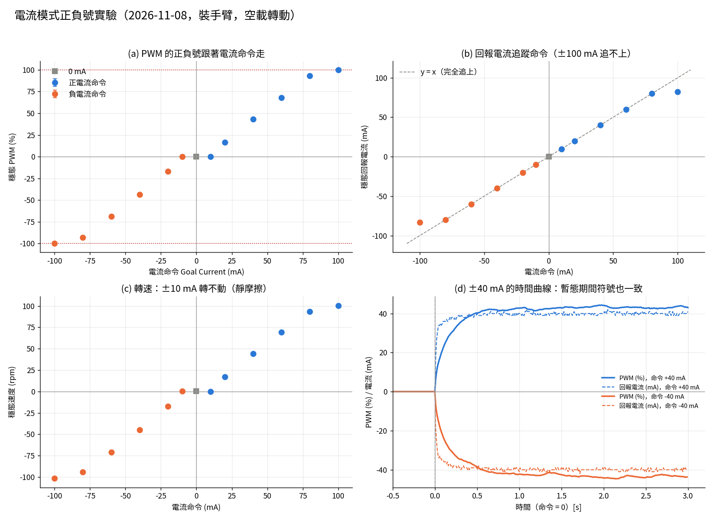
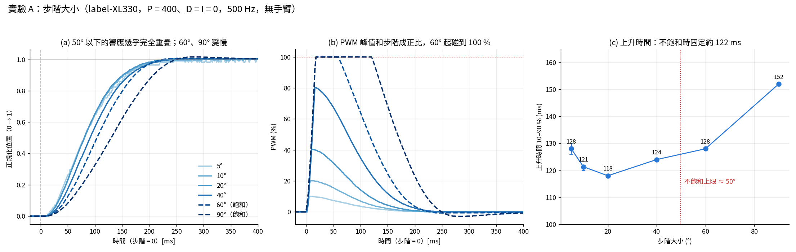
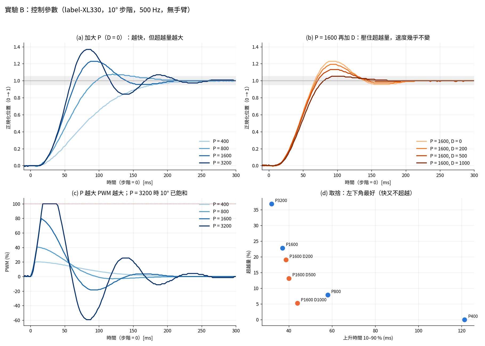
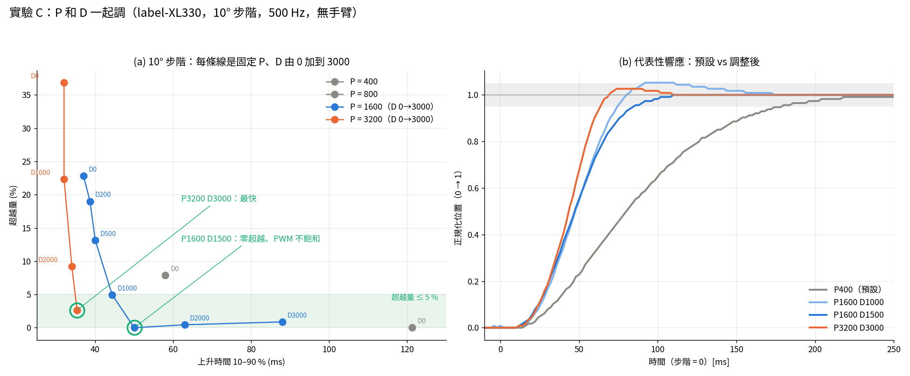
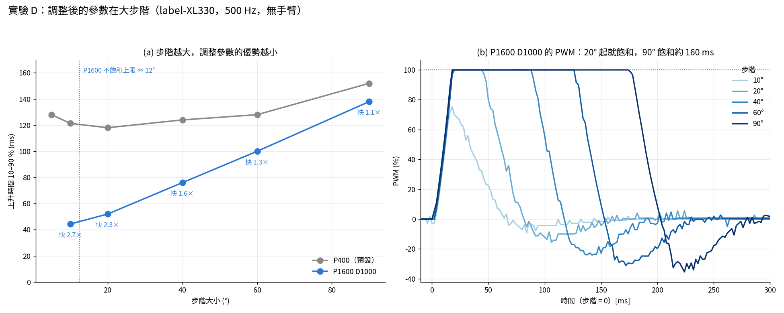

# 11/08 實驗紀錄：電流模式的正負號（老師 11/08 信第 1 點）

## 結論
**負的電流命令會產生負的 PWM，而且正負兩邊幾乎完全對稱。** 全部 12 個非零命令，PWM 的正負號都和命令一致；暫態期間符號也一致。

## 條件
- 馬達：標籤 XL330（由速度判斷：20 mA 時 17 rpm，和 11/06 的 XL330 一致；標籤 XC330 在 80 mA 時只有約 14 rpm）
- 裝著手臂，手臂可以自由轉動（空載）；電流模式 `c N`，每筆 1 s 基準 + 3 s 命令
- 順序：`c 0`，再 ±10、±20、±40、±60、±80、±100 mA 正負交替（一輪）
- 穩態 = 命令最後 1 s 的平均（100 點），誤差 = 標準差；通訊逾時 2 / 5200 筆

## 結果

| 命令 (mA) | PWM (%) | 回報電流 (mA) | 速度 (rpm) |
|---|---|---|---|
| −100 | −100.0 | −83.3 | −101.5 |
| −80 | −93.0 | −80.0 | −94.1 |
| −60 | −69.0 | −59.9 | −71.1 |
| −40 | −43.6 | −40.0 | −45.1 |
| −20 | −16.7 | −20.0 | −17.3 |
| −10 | −0.14 | −10.0 | 0.1 |
| 0 | 0.00 | 0.0 | 0.2 |
| +10 | +0.20 | +9.9 | 0.0 |
| +20 | +16.7 | +20.0 | +17.2 |
| +40 | +43.1 | +40.1 | +44.2 |
| +60 | +67.8 | +60.0 | +69.1 |
| +80 | +93.1 | +80.0 | +93.5 |
| +100 | +100.0 | +82.2 | +100.2 |

## 說明
1. **符號**：負命令 → 負 PWM、負電流、反轉；正負同大小時，PWM 差異 ≤ 1.2 個百分點（60 mA 時 67.8 vs 69.0 %），速度也對稱。
2. **電流追蹤**：±80 mA 以內，回報電流和命令幾乎相同（y = x）。±100 mA 時 PWM 已到 ±100 %，電流只到 82–83 mA：空載全速（約 101 rpm）時反電動勢用完了電壓，這就是空載時電流上不去約 80 mA 的原因。
3. **靜摩擦**：±10 mA 時馬達沒有轉，PWM 只有約 0.2 %。
4. **要注意的一點**：±10 mA 時 PWM 只有 0.2 %，回報電流卻是 10 mA；`c 0` 時讀到 0 mA。若回報值是包含待機電流的電源總電流，`c 0` 應該讀到約 20–30 mA。這表示回報值至少不是「電源總電流」這麼單純，11/06 擬合出的 I₀ = 28 mA 要保守看待。最好用電源線串電阻的獨立量測確認（老師第 3 點也和這個有關）。

## 檔案
- `data/current_explore_20261108.txt`：原始紀錄（前段是測試，掃描從 `> c 0` 開始）
- `data/current_sign_summary_20261108.csv`：穩態彙整
- `figures/current_sign_1108.png`、`analysis/analyze_current_sign_1108.py`

---

# 11/08 實驗紀錄：位置小步階與控制參數（老師 11/08 信第 2 點）

韌體 v4（`s` 指令，500 Hz，每筆 `late_slots=0`），標籤 XL330，無手臂，從 180° 附近出發。共 31 次。
原始：`data/step_label-XL330_20261108.txt`；彙整：`data/step_runs_…csv`（每次）、`data/step_summary_…csv`（平均）；
程式：`analysis/analyze_step_1108.py`。

## 結論
1. **PWM 不飽和時，上升時間和步階大小無關，固定約 122 ms**（5–40°：118–128 ms）。90° 步階飽和約 100 ms，上升時間 152 ms。不飽和的確比較快，但只快約 20 %。
2. **預設參數下，慢的主因是 P 太小，而不是飽和。** 10° 步階只用到 20 % PWM。
3. **加大 P 明顯加快**：P = 400 → 800 → 1600 → 3200，上升時間 121 → 58 → 37 → 32 ms，但超越量 0 → 8 → 23 → 37 %。
4. **加 D 可以壓住超越量、幾乎不損失速度**：P = 1600 時 D = 0 → 1000，超越量 23 → 5 %，上升時間 37 → 44 ms，安定時間 132 → 112 ms。目前最好的組合 **P = 1600、D = 1000**，比預設快約 2.8 倍。
5. 所有條件下，位置都要在步階後約 **15–17 ms** 才開始動，PWM 也約 15 ms 才爬到峰值。這段延遲不隨增益改變，是響應速度的下限。
6. **PWM = P / 256 × 位置誤差 [raw]** 再次驗證：峰值 PWM 和步階成正比（5°→10 %、10°→20 %、20°→41 %、40°→80 %）。
7. 超越量符合二階系統：由超越量算出阻尼比 ζ，P = 800 約 0.63、P = 1600 約 0.43，比值約 √2，和「ζ ∝ 1/√P」一致。

## 數據（同設定平均）

| 步階 | P | D | 次數 | 上升 10–90 % (ms) | 超越量 (%) | 安定 (ms) | PWM 峰值 (%) | 飽和 (ms) |
|---|---|---|---|---|---|---|---|---|
| 5° | 400 | 0 | 2 | 128 | 0 | 186 | 10 | 0 |
| 10° | 400 | 0 | 3 | 121 | 0 | 180 | 20 | 0 |
| 20° | 400 | 0 | 2 | 118 | 0.4 | 175 | 41 | 0 |
| 40° | 400 | 0 | 2 | 124 | 0.2 | 186 | 80 | 0 |
| 60° | 400 | 0 | 2 | 128 | 0.7 | 190 | 100 | 42 |
| 90° | 400 | 0 | 2 | 152 | 1.6 | 224 | 100 | 103 |
| 10° | 800 | 0 | 3 | 58 | 7.9 | 158 | 40 | 0 |
| 10° | 1600 | 0 | 2 | 37 | 22.8 | 132 | 79 | 0 |
| 10° | 3200 | 0 | 2 | 32 | 36.8 | 201 | 100 | 21 |
| 10° | 1600 | 200 | 3 | 39 | 19.0 | 131 | 79 | 0 |
| 10° | 1600 | 500 | 3 | 40 | 13.2 | 131 | 78 | 0 |
| 10° | 1600 | 1000 | 3 | 44 | 5.3 | 112 | 77 | 0 |

安定時間：最後一次離開 ±5 % 步階（至少 ±2 raw）的時間。重複性很好：同設定的上升時間最多差 4 ms。

## 注意
- P = 1600 時，不飽和的步階上限只有約 12°；更大的步階還是會飽和。高增益在大動作時的表現要另外測。
- 90° 步階有 33 / 2000 筆讀取錯誤、P1600 D200 有 8 筆；分析時已剔除，不影響結果。
- I gain 還沒測；目前穩態誤差在 0.1–0.3° 以內。

## 下一步
- D 再加大（1500、2000）或 P = 3200 搭配 D，看能不能做到「快且零超越」。
- 用 P = 1600、D = 1000 測 20°、40°（會飽和），看大步階時是否仍比預設好。
- 標籤 XC330 用同樣的指令做一次（摩擦較大，預期更慢、穩態誤差更大）。

---

# 11/08 第二輪：D 加大（實驗 C）與大步階（實驗 D）

原始：`data/step2_label-XL330_20261108.txt`；兩輪合併：`data/step_all_runs_…csv`、`data/step_all_summary_…csv`；
程式：`analysis/analyze_step2_1108.py`。全部 `late_slots=0`。實驗 D 每個步階只做 1 次。

## 結論
1. **P1600 D1500：零超越**，上升 50 ms、安定 86 ms，PWM 最高 72 %（10° 時不飽和）。
2. **P3200 D3000：最快**，上升 35 ms、超越 2.6 %、安定 65 ms；10° 時 PWM 飽和約 7 ms。和預設 P400 比，上升快 3.4 倍、安定快 2.8 倍。
3. D 太大會變慢：P1600 時 D2000 → 63 ms、D3000 → 88 ms（超越量已經是 0，再加 D 只會拖慢）。
4. P3200 時，加 D 幾乎不影響上升時間（32–35 ms），因為上升段被 PWM 飽和限制住，D 主要作用在煞車段。
5. 停止後 PWM 的跳動量都 < 2 %，沒有觀察到 D 太大造成的抖動或嗡嗡聲。
6. **大步階時調整參數的優勢越來越小**：P1600 D1000 相對預設，上升時間 20° 快 2.3 倍、40° 1.6 倍、60° 1.3 倍、90° 只快 1.1 倍。大步階大部分時間 PWM 都是 100 %（90° 時約 160 ms），速度被馬達最高轉速限制，參數改不了。
7. 大步階的超越量（4–7 %）和 10° 時差不多，沒有因為飽和而變差。−40° 和 +40° 幾乎相同（上升 76 vs 76 ms、超越 5.7 vs 6.2 %），正負對稱。

| 步階 | P | D | 次數 | 上升 (ms) | 超越 (%) | 安定 (ms) | PWM 峰值 (%) | 飽和 (ms) |
|---|---|---|---|---|---|---|---|---|
| 10° | 1600 | 1000 | 6 | 44 | 5.0 | 97 | 75 | 0 |
| 10° | 1600 | 1500 | 3 | 50 | 0.0 | 86 | 72 | 0 |
| 10° | 1600 | 2000 | 4 | 63 | 0.4 | 108 | 70 | 0 |
| 10° | 1600 | 3000 | 3 | 88 | 0.9 | 127 | 65 | 0 |
| 10° | 3200 | 1000 | 2 | 32 | 22.4 | 122 | 100 | 17 |
| 10° | 3200 | 2000 | 2 | 34 | 9.2 | 100 | 100 | 12 |
| 10° | 3200 | 3000 | 3 | 35 | 2.6 | 65 | 100 | 7 |
| 20° | 1600 | 1000 | 1 | 52 | 6.6 | 138 | 100 | 28 |
| 40° | 1600 | 1000 | 1 | 76 | 6.2 | 168 | 100 | 72 |
| −40° | 1600 | 1000 | 1 | 76 | 5.7 | 166 | 100 | 70 |
| 60° | 1600 | 1000 | 1 | 100 | 5.3 | 196 | 100 | 108 |
| 90° | 1600 | 1000 | 1 | 138 | 3.8 | 202 | 100 | 158 |

## 給老師第 2 點的回答
- PWM 不飽和時，響應確實比飽和時快，但在預設參數下只快約 20 %（122 vs 152 ms）；預設參數慢的主因是 P = 400 太小。
- 調整參數可以大幅加快：P1600 D1500（零超越）快 2.4 倍，P3200 D3000（超越 2.6 %）快 3.4 倍。
- 但只對小步階有效；步階越大越受 PWM 飽和與最高轉速限制，90° 時參數幾乎沒差。
- 約 15 ms 的啟動延遲不隨參數改變，是硬體的下限。

## 待做
- 大步階用 P1600 D1500、P3200 D3000 各做一輪，並每個做 3 次。
- 換標籤 XC330 做同樣的測試。
- 高增益在 RL 訓練中是否合適（模擬中的致動器模型要用同一組參數），要和老師討論。

---

# 11/09 討論紀錄：老師的提問、我們的回答、Microduck 原始碼

## 老師 11/09 的問題
1. 定位控制是用 PWM 還是電流當控制輸入？
2. 能不能理解為什麼要做這些測試？
3. H 橋輸入電壓可以找老師的學生一起研究；照技術文件（v3.1 PDF）做實驗，量馬達線圈的電阻與電感，再把馬達模型鑑別出來，讓模型能解釋所有實驗數據。
4. 沒有積分控制、靜摩擦又不小，為何定位控制下看不到穩態誤差？

## 問題 1：控制輸入是 PWM（把握：高）
- Mode 3 寫入並讀回確認。
- **PWM ÷ 位置誤差固定 = P/256**（P=400 時 1.56），PWM 峰值隨 P 等比例放大（10° 步階：P400 20.1 %、P800 40.3 %、P1600 約 80 %）。
- **這個比值和轉速無關**：11/06 的 90° 步階中，轉速從 96 降到 53 rpm，比值一直是 1.56。若有內層電流迴路，duty = (R·K·誤差 + kₑ·ω)/V，會出現和轉速成正比的項；沒有看到，所以 duty 只是誤差的函數。
- 同一段過程中回報電流降到 0 mA（誤差還有 373 raw），沒有和誤差成比例 → 被控制的不是電流。
- 未確認：Present PWM（暫存器 124）是否等於 H 橋實際 duty；要用示波器 + 差動探棒跨馬達兩端確認。

### 附帶發現：減速段回報電流是 0，不是負值（把握：中）
90° 步階後段，馬達在減速（反電動勢 > 外加電壓），線圈電流理論上應為負（煞車），但回報值是 0；電流模式反轉時卻會回報 −40 mA。推測負號跟驅動方向給，煞車的反向電流沒有被回報 → 比較像在電源端量電流。要用外量電流確認。

## 問題 2：測試的目的（我們的理解，把握：中高）
建立能用於模擬／RL 的馬達模型，並用實測驗證：
- 電氣：L·di/dt = d·V_bus − R·i − kₑ·ω
- 機械：J·ω̇ = kₜ·i − τ_摩擦 − τ_負載（含減速比與齒輪效率）
- 控制器：mode 3 為 d = sat(P/256 × 誤差)

| 測試 | 確認的部分 |
|---|---|
| 負電流 → 負 PWM | 輸入 d 有正負號，H 橋雙向 |
| 不飽和小步階 | 分開線性動態與飽和 |
| H 橋輸入電壓 | 模型中真正的 V_bus |
| 線圈 R、L | 電氣參數、時間常數 L/R |

- **R 必須直接量**：電流模式空轉時電流和轉速幾乎成正比，R·i 和 kₑ·ω 從這些數據分不開。
- 一致性粗估（把握：中低）：由電流模式 80 mA / 93 % / 93.5 rpm / 4.67 V 估出 kₑ ≈ 0.41–0.44 V·s/rad（輸出端）；堵轉 d = 1 時 kₜ ≈ 0.33 N·m/A → 比值約 0.75–0.8，可解釋為齒輪效率。空載 101 rpm @ 4.67 V 和原廠 103 rpm @ 5 V 相近。

## 問題 4：為何幾乎沒有穩態誤差
**理論**：
1. 受控體 PWM（電壓）→ 轉速 → 位置，本身含 1/s，是 type 1。對步階參考輸入，在沒有擾動時，只用 P 控制穩態誤差就是 0。
   - 注意：e_ss = 1/(1+K_p) 是型 0 系統的公式，K_p 是開迴路 DC 增益（不是控制器 P gain）；型 1 時 K_p = ∞。
2. 靜摩擦是加在受控體輸入端的擾動，受控體的積分器在擾動之後，消不掉 → 會留下 ±d_f / K_P 的死區（d_f = 克服靜摩擦需要的 PWM，K_P = P/256）。只有控制器裡的 I 才能消除。

**實測（兩輪共 54 次步階，取步階後 1.0–1.8 s）**：

| 停止位置 − 目標 | 次數 |
|---|---|
| 0 raw | 42 |
| ±1 raw（±0.09°，編碼器解析度） | 10 |
| −1 ~ −2 raw | 1（−40°，P1600 D1000） |
| **+3 ~ +4 raw（0.26–0.35°）** | **2（60°，P400，兩次一致）** |

- 60° / P400 那兩次：控制器輸出 **−0.5 % PWM**（= P/256 × 3.5 raw）卻**推不動** → 靜摩擦死區的直接證據，d_f **≥ 0.5 %**。
- ⚠ 更正：之前說「0.5 % 就能克服靜摩擦」是錯的；0.5 % 是下限。
- 由電流模式估 d_f：`c 10` 不動、`c 20` 會轉 → 起動電流 10–20 mA；靜止時沒有反電動勢，換算 duty 約 **0.8–1.5 %**（R ≈ 3.7 Ω 粗估，把握：中）。
- 電流模式維持 17 rpm 的 PWM 16.7 % 不是起動門檻：拆成 kₑ·ω ≈ 0.76 V（約 15.5 %）+ R·i ≈ 0.07 V（約 1.5 %），九成是反電動勢（R、kₑ 粗估，把握：中低）。
- d_f 若是 0.8–1.5 %，P400 的死區應是 ±4.5–8.5 raw，但實測多為 0–1 raw：馬達是帶著速度滑進目標附近才停（動摩擦 < 靜摩擦），停下時通常已在死區內靠近目標的位置。
- 有幾次停在 +1 raw 但 PWM 讀 0（預期 1–2 格）：可能是韌體 ±1 raw 死區或捨去，未確認。

**待驗證**：P = 50、100、200 做 10° 步階（`s 10 50` 等），死區應放大到約 1–3°，確認誤差 ∝ 1/P 並直接量出 d_f。

## Microduck 原版的控制方式（讀 pollen-robotics/microduck 與 microduck_rl 原始碼，11/09，把握：高）
- **Mode 3 位置控制、PWM 輸入**：`microduck_rl/scripts/testbench_sim2real.py` 寫入 `write_operating_mode(motor_id, 3)  # position control`；機器人程式（`microduck/duck-control/src/io.rs`）只用 `sync_write_goal_position` 送目標角度（50 Hz）。
- **增益**：走路 P = 200（站立 ×0.8 = 160、跌倒放軟 50），I = D = 0（RAM，每次開機寫入）。
- **模擬用 BAM M6 電壓控制模型**：BAM `XL330Actuator` 是 `VoltageControlledActuator`，`XL330_KP_DIVISOR = 256`、`XL330_PWM_LIMIT = 885`，和我們實測的 PWM = P/256 × 誤差完全一致。
- `deploy/robotd.toml`：「The servos' effective kP tracks their supply」→ 依電池電壓縮放動作（電壓控制的後果）。電池 2S 7.4 V（模擬隨機 6.5–8.2 V）；7.4 V 時 P=200 約等於 5 V 時 P=296。
- 啟動時設 `return_delay_time=0`、`pwm_slope=255`、`shutdown=52`、膝關節 homing offset −512。
- **PWM Slope = 255**：可能解釋我們每次步階 PWM 都要約 15 ms 才爬到峰值（預設 PWM Slope 較小？未查證，把握：低）。
- 程式**不寫 Operating Mode**，依賴出廠預設 3 → 我們改過模式的測試馬達，裝上鴨子前要改回 3。
- BAM 另有 `XL330CurrentActuator`（mode 5），假設回報值是 bus 電流 I_bus = duty × I_phase，文件註明 **UNTESTED** —— 和老師懷疑的電流定義是同一個問題。
- 不同處：Pollen 文件說出廠 D 不為 0；我們兩顆讀回 PosD = 0（韌體版本差異？）。

### 對專題的影響
- 我們找到的 P1600 D1500 / P3200 D3000 不能直接用在鴨子上：policy 在 kp_fw = 200 下訓練，改增益要重新訓練。
- 鴨子的工作點是 P = 200、約 7.4 V：穩態誤差、響應速度應在這個條件下量。

Sources：github.com/pollen-robotics/microduck、github.com/pollen-robotics/microduck_rl、bam.readthedocs.io（bam.dynamixel.actuator）

## 下一步（11/09）
1. 低 P 穩態誤差實驗：`s 10 50`、`s 10 100`、`s 10 200`、`s 10 400` 各 3 次（約 10 分鐘），補進回信。
2. 照 PDF 第 1 步：拆一顆（建議標籤 XC330 那批，先問老師）→ 拍 PCB、量線圈 R（4 線式、5 個轉子位置）與 L（LCR 表）、板端 V_bus（待機／定電流／定速度）；和老師的學生一起研究 H 橋電壓量法。
3. 之後：在一條馬達線外量電樞電流，和 Present Current 比對（含減速段、±電流、堵轉掃描）。
- 小任務：14 顆「XC330」掃 Model Number、秤重；查 PWM Slope 暫存器（位址與預設值待查 e-Manual）並測它對 15 ms 延遲的影響；在 P=200、7.4 V 條件下重做步階。
