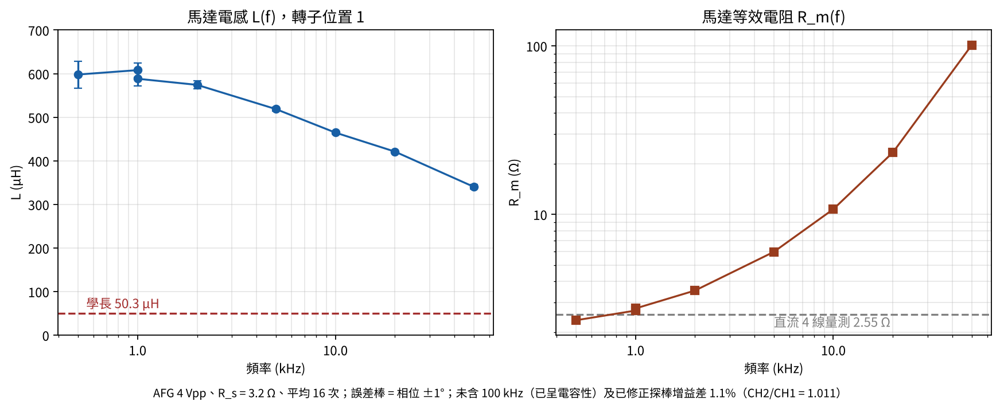

# 11/19 實驗紀錄：線圈電阻 R 與電感 L（拆開的馬達）

對應文件：老師 v3.1 計畫 §4（電樞電阻）、11/06〈電流量測核對〉§2（Ra、La）、老師 11/09 信第 3 點（量線圈 R、L）。

- 對象：拆開的那顆 XL330 馬達（與原驅動板隔離，只量馬達兩端）。⚠ 請補上這顆的標籤與編號。
- 儀器：GW Instek GPE-4323 電源供應器、三用電表、AFG-2225 函數產生器、MDO-2202EX 示波器（×10 探棒）
- 室溫：未記錄（⚠ 下次補）

---

## 1. 結論

| 項目 | 數值 | 把握 |
|---|---|---|
| 線圈直流電阻 R（4 線法，位置 1） | **2.55 Ω** | 高 |
| 低頻電感 L（0.5–2 kHz，位置 1） | **≈ 0.59 mH**（574–608 µH） | 中高 |
| 電氣時間常數 τ = L/R | **≈ 0.23 ms**（轉折頻率 ≈ 0.7 kHz） | 高 |
| 高頻行為 | L 隨頻率下降、R_m 上升（鐵芯渦流）；約 100 kHz 變成電容性 | 中 |

1. **R ≈ 2.55 Ω**：直流 4 線法與交流低頻（500 Hz–1 kHz 的 R_m = 2.35–2.76 Ω）兩種方法一致。
2. **L ≈ 0.6 mH**，比學長量到的 50.3 µH 大約 10 倍。差異原因未確定，可能是量測頻率或方法不同，要跟學長確認。
3. **電氣動態在 RL 模擬（50 Hz）中可以忽略**：τ ≈ 0.2 ms ≪ 20 ms 控制週期 ≪ 機械時間常數。模擬可用靜態電壓模型 i = (d·V_bus − kₑω)/R（即 BAM M6 的假設），不需要加電感狀態。
4. **頻率升高後線圈不是單純的 RL**：50 kHz 時 L ≈ 0.34 mH、R_m ≈ 100 Ω；100 kHz 呈電容性。短路校正證明這是馬達本身的特性。只在分析 PWM 漣波、電流感測時需要考慮。
5. 對 dither 的意義（推論）：數十 Hz 的 dither，阻抗 ≈ R，代價主要是銅損 I²R；數 kHz 以上，電感與鐵芯損耗會吃掉大部分能量。

---

## 2. 直流電阻（4 線法）

### 方法
- GPE-4323 定電流輸出（0.20–0.40 A，每次 0.05 A），電源線接馬達兩端。
- 電表的表筆**直接點在馬達端子上**量電壓（4 線法：電流線與電壓線分開，排除導線與接觸電阻）。
- 正向、反向各做一次；轉子固定在同一位置。

### 數據（`data/R_4wire_20261119.csv`）

| I (A) | V 正向 (V) | V 反向 (V) |
|---|---|---|
| 0.20 | 0.499 | −0.499 |
| 0.25 | 0.612 | −0.628 |
| 0.30 | 0.767 | −0.747 |
| 0.35 | 0.895 | −0.892 |
| 0.40 | 1.022 | −1.057 |

### 結果
- 正向直線擬合：2.66 ± 0.07 Ω（截距 −38 mV）
- 反向直線擬合：2.76 ± 0.10 Ω（截距 −63 mV）
- **全部資料通過原點擬合：R = 2.548 Ω**
- 截距小且在誤差範圍內，沒有明顯的電刷壓降；正反向一致。
- 圖：`figures/R_VI_1119.png`；程式：`analysis/plot_R_1119.py`

### 和舊估計比較
- 11/06 堵轉 d = 1 時 4.40 V / 1.18 A = 3.72 Ω 是「H 橋看到的路徑電阻」，含 R500、MOSFET、接頭，而且回報電流的大小還沒驗證，**只作參考**。
- 3.72 − 2.55 ≈ 1.2 Ω 可能是線圈以外的電阻；要等量到 V_bus 和外量電流才能確認。

---

## 3. 電感（交流阻抗法）

### 3.1 原理
在馬達上串聯一顆已知電阻 R_s，用正弦波驅動；R_s 上的電壓代表電流，總電壓與電流的相位差代表電抗。

### 3.2 接線
```
AFG CH1 (+) ──●A── 馬達 ──●B── R_s 3.2 Ω ──●C── AFG (−)
```
- 實際使用：**CH1 夾 B**（R_s 電壓 V₁ → 電流），**CH2 夾 A**（總電壓 V₂），兩支探棒地夾都在 **C**。
- MATH = CH2 − CH1 = 馬達電壓（只作參考，見 3.6）。
- AFG 與示波器的地經插頭共地，所以地夾只能夾 C。
- R_s 實測：用 GPE-4323 通 0.20 A、量兩端電壓，R_s = V/0.20 = **3.2 Ω**。

### 3.3 設定
- AFG：Sine、**4 Vpp**（50 Ω 負載設定）、Offset 0 V
- 示波器：DC 耦合、×10、Acquire **平均 16 次**；兩條波形各佔 4–6 格、不可被切到
- 時基 ≈ 週期 / 2（畫面 4–5 個週期）
- 量測：CH1 RMS、CH2 RMS、相位 CH1→CH2

### 3.4 公式
量到 V₁（CH1 RMS）、V₂（CH2 RMS）、φ（電壓超前電流的角度；示波器顯示負值時取正，顯示正值表示電容性，取負）、K = 1.011（探棒增益 CH2/CH1）：

1. 電流：I = V₁ / R_s
2. 總阻抗：|Z_t| = V₂ / (K·I) = (V₂/V₁)·(R_s/K)
3. 拆成實部與虛部：R_t = |Z_t| cos φ，X_t = |Z_t| sin φ
4. 扣掉 R_s（純電阻，只扣實部）：**R_m = R_t − R_s**，X_m = X_t
5. **L = X_m / (2πf)**
6. 誤差（相位誤差 δφ，單位 rad）：δR_m ≈ |Z_t| sin φ · δφ，δL ≈ |Z_t| cos φ · δφ / (2πf)

**R_m 是什麼**：馬達阻抗的實部，代表被消耗掉的功率（P = I²R_m）。不是一顆真的電阻，而是把所有損耗折算成等效串聯電阻。低頻時就是銅線電阻；數 kHz 以上再加上鐵芯渦流、磁滯損耗與集膚效應，所以隨頻率上升。L 是儲存在磁場、每週期還回來的部分；渦流會抵消部分磁通，所以 L 隨頻率下降。

### 3.5 校正
| 測試 | 讀數 | 結果 |
|---|---|---|
| 探棒增益比對（兩支探棒夾同一點，1 kHz） | CH1 180 mV、CH2 182 mV、相位 −0.6° | 增益比 **K = 1.011**，已修正；相位 0.6° 在 ±1° 誤差內，不修正 |
| 短路校正（拿掉馬達、A–B 短接，100 kHz） | CH1 181 mV、CH2 192 mV、相位 −1.7° | 扣掉增益後多出約 0.16 Ω（短接線＋夾子接觸電阻）；導線電感 ≈ 0.16 µH，可忽略 |

- 短路時相位只有 1.7°，而接馬達時 100 kHz 是 −18.9°（電容性）→ **電容性是馬達本身的**。
- 交流量到的 R_m 含夾子接觸電阻約 0.1–0.2 Ω；直流的 2.55 Ω 是 4 線法，沒有這個誤差。
- 檔案：`data/L_short_cal_20261119.csv`

### 3.6 MATH 相位不可靠
- 1 kHz 時 CH1→MATH 的相位兩次分別讀到 −42° 與 −2.9°，差很多。
- 用 CH1、CH2 反推馬達電壓（V⃗_m = V⃗₂ − V⃗₁）：幅值 250 mV，與 MATH RMS 252 mV 吻合；相位 52.9°，與 MATH 相位 42° 不合。
- → MATH 的 RMS 可信，**MATH 的相位不可信**。全部改用 CH1、CH2 和相位 1→2 計算。

### 3.7 數據與結果（轉子位置 1，已修正 K）
原始：`data/L_sweep_pos1_20261119.csv`；圖：`figures/L_R_vs_f_1119.png`；程式：`analysis/plot_L_1119.py`

| f | V₁ (mV) | V₂ (mV) | 相位 1→2 | I (mA) | L (µH) | R_m (Ω) |
|---|---|---|---|---|---|---|
| 500 Hz | 175 | 324 | −18.7° | 54.7 | 598 | 2.35 |
| 1 kHz（500 µs/div） | 171 | 379 | −31.8° | 53.4 | 588 | 2.76 |
| 1 kHz（200 µs/div） | 171 | 379 | −33.0° | 53.4 | 608 | 2.68 |
| 2 kHz | 170 | 530 | −47.0° | 53.1 | 574 | 3.53 |
| 5 kHz | 156 | 922 | −60.6° | 48.8 | 519 | 5.98 |
| 10 kHz | 135 | 1380 | −64.5° | 42.2 | 465 | 10.7 |
| 20 kHz | 100 | 1870 | −63.4° | 31.3 | 421 | 23.3 |
| 50 kHz | 49.0 | 2310 | −45.8° | 15.3 | 341 | ≈ 101（±2 Ω/°） |
| 100 kHz | 33.5 | 2380 | **+18.9°（電容性）** | 10.5 | — | — |

- 第一筆 1 kHz（AFG 1 Vpp、未開平均：V₁ 43.0、V₂ 91.5 mV、31.7°）得 L = 570 µH，與 4 Vpp 的結果相差 < 5%，電感與激勵大小無關（在小訊號範圍內）。
- 100 kHz 不畫進 L 圖（已呈電容性，L = X/ω 的定義不適用）。
- 相位越大、頻率越高，R_m 越不準（10 kHz 時每 1° ≈ 0.5 Ω，50 kHz 時每 1° ≈ 2 Ω）；L 的誤差小得多。



### 3.8 等效電路擬合（全部 9 點，含 100 kHz，修正 K 之前）
| 模型 | 擬合誤差 |
|---|---|
| (R + L) ∥ C | 40%，不符 |
| R₀ + (L ∥ R_p) | 18% |
| **[R₀ + (L ∥ R_p)] ∥ C** | **9%** |

最佳：R₀ ≈ 2.66 Ω、L ≈ 0.52 mH、R_p ≈ 216 Ω（鐵芯損耗）、C ≈ 6.5 nF（與 L 約 90 kHz 共振）。
6.5 nF 對繞線寄生電容太大，可能是馬達端子上焊了抑制雜訊的電容（⚠ 待拍照確認）。

### 3.9 為什麼不用 buffer
1. **電流在 AFG 能力內**：AFG 輸出內阻 50 Ω、有短路保護。最小負載約 R_s + R_m ≈ 5.8 Ω，4 Vpp 設定時 I_peak ≈ 4 V / 55.8 Ω ≈ 72 mA（51 mA rms）；實測 53–55 mA rms，與估算一致（也驗證了 50 Ω 內阻），過載保護從未動作。
2. **被動負載的回充電流不可能超過短路電流**：|I| = V_open / |50 + Z| ≤ V_open / 50 Ω（因為 Re Z ≥ 0）。線圈儲能 ½LI² ≈ 1.6 µJ，正弦激勵也沒有電流突然中斷造成的感應突波。
3. **沒有反電動勢**：轉子固定。若轉子被轉動，反電動勢是外加電壓源，要求它低於 AFG 輸出能力（約 ±10 V，待查手冊）；XL330 最多約 4–5 V。
4. **AFG 內阻不影響結果**：Z = V/I 都由示波器在馬達端直接量，沒有用到 AFG 的設定值。
5. **實測波形乾淨**：振幅 ≈ RMS × 2√2，沒有截波或失真。
- **需要 buffer 的情況**：電流需要 > 約 100–200 mA（例如量 0.5–1 A 的大訊號電感、鐵芯飽和）、需要低內阻電壓源、需要直流偏壓加交流、或負載是主動電源。

### 3.10 限制
1. 只量了一個轉子位置（R 與 L 都是）。
2. 小訊號：電流 10–55 mA，遠小於運轉時約 1 A；大電流時鐵芯可能飽和、L 變小。
3. 轉子固定，量的是純電氣阻抗。
4. 交流 R_m 含夾子接觸電阻約 0.1–0.2 Ω。
5. R_s 只有兩位有效數字（3.2 Ω）；室溫未記錄。

---

## 4. 下一步（本實驗收尾）
1. 轉子位置 2、3：L 量 1k、10k、50k；R 用 4 線法量 5 個位置並記溫度（計畫 §4 要求）。
2. 拍馬達端子近照，確認有沒有抑制雜訊電容。
3. 問學長量 50.3 µH 時用的頻率與方法。
4. 量完補上室溫、R_s 再量一次（三位有效數字）。
